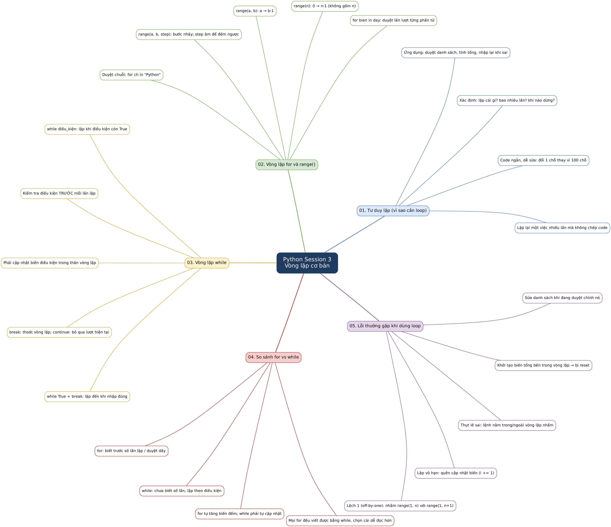

# Mindmap Python Session 3 - Vòng lặp cơ bản

Sơ đồ tư duy tổng hợp kiến thức Session 3 của khóa Python: tư duy lặp, vòng lặp `for` và `range()`, vòng lặp `while`, so sánh `for` với `while` và các lỗi thường gặp khi dùng vòng lặp.

🔗 **Link mindmap (draw.io):** [Mở mindmap trên draw.io](https://www.draw.io/#R3Zxbc5s4FMc%2FDTPJQ3Z04%2FboS7MPbWc6m87uvmWwTQwTDCnGSb2ffnUDIyTS7NrSDO5LjUBgSz%2BdnPM%2FR3h4sfv5lBephz95eLHJk22d7DwEymRH25YeQl%2FzcrNLXugncc3u5%2B918pJ9rTZpIVrqqmrac4u0KGj3fCM6A9YN3Y%2BchfwseEnqtGw%2B0oE%2Fifd5TYqD%2FILfjk1WlbTtId3vc%2F4Jeygo6B3nq5p%2B2rJPf3oL7M1RuaWnC%2B8T9OYzbx7SnwXW3iLwZvS7gJVsn%2BFSPGXfHIu0ffSh3KTse0B6t7csb9KHl2TNzr7R8aBtWbMr5Gk6osWiKqqa98XwCSf%2BE2uvyqbX%2FsT%2F0fZ9U1fP6ViPh%2Fwf9hg6NvJYfiv2JDkaad2kP0cHFfYnL612aVMf6SWyQxyEostRHEcRFsdv%2BabJRBtCRLRlab7N5G1DJNqSvTjedrc%2BTSH9IGfRPKMF0OYTwN9ow3c2K3N6FmwOR23Obl7ZdM4WbI6Sik%2BinLqQzX9RVS%2B3F53CTZJGT2vTVAXrKF0Npgr6dqYKIhIpcxXCSJ%2BrAOtzhYPz5yptJ6s3pmm5mdV19UaPyqqkjfP1oX7tBnl8tMSZv%2BTXxt34pJtt%2Bv7o0OdXh3qdDk1Ck9TbtOljpY9jnRZJk7%2BqTziP30ed4C8Kqy25M5jTox0%2Fmntx3LBOuTyMwjWzull3DA%2F9rpzqHWeeLYnnjFszwq3Zmh%2FMYm7LqFW%2BKPfjJsrIPb4Q5xFAKuehzjkm9jh%2FtEY6%2Bt%2Bkt6tP5fzRIelQI33BeQOUQwnqPQWVWeVNy7HPfoU8mC0TD89og7cgXgzbleCzdQEFybIpZL8zS9gPOVl6CMDwoumTHrYUS9J9AnXSUWyPdDgZ0qE70pFG%2Bt8cQ7ge0hvNy0xArXmVWJr8rSQY3zMfk7srzNCzxtnQyvNrnjPWrRTmvuqtptmcrjR2yfS59%2BNY4R5jA%2FcBsMc9mgz3yB33WOO%2BJS%2FivkYHos9AnEnvvHVhmEezSeh6YCZfLJdM%2FDlo%2BOGSn2o6u89uueCroV0BS91hEothn%2BTXQD0BvkI9DPRYC8cWqceToR67ol73agBiEei4YvBEx6J1TJhLUiflNr25cMDpp9GGmCYgQiscBG4CzigeeCd%2BYNAGIlu8nu%2BbdINlOd505ptAQ7wpeFzlKYsS85Jb4aPZPKsRZSFFFmnUcdMzz9zXoMORKT26s0tH5thI%2B6XMMQVaxRvo1hhaizLhBaLMEb7PsMbQRLe7KBMaokxhX8tbgTSzuN4n5EWBF7MLyzsWO94omsi29TEwF7NvrwFWAFXtT2cVEWKPVTgZVh3aYjTCaiIc25VENhkgu7qDV0BkBAfObKgRScM8e0SiyRCJ3BGJf0Gk%2BG%2FfpC%2BSzZXiA8TztRKQ4SMfC96BSx%2FU5UU7TQTBagt1lO93QhdUHYz1FWBPQqJg3woZfachtIg9ngz27kK4R6Jhvxx4vuvs0AnHuUBf%2BM1MoxBeM80V%2FziwXPa8zSm3x1eALSZqmhcZhGbUinA2uCWT4Za44lZ3HwB%2BX3qgpBUXz%2FChtTGzvQlWge9IaAjIwKgCnU4Y%2BLboPN%2BV6AbLstDgzJVABqFB0if%2F1Pdy1Y%2FPp0R2aUqHCBVX68fO9HvKvAlFn5WA1AdXyWwj6hdLdagaGsFIdxiANQ0NXUBlGIH7DMOLTGi7UxmQQWX43IHIRYOmTj5G7Pc%2FeAHZfetd8Fz1rudr6Kpbb2VMHu9AVSUCX48CaaRoj244GbqhO7p1x%2BLbKaTL%2B%2FVyPOPWS8A1XEnuorjyY2uADhx3VhpRi8TN9%2BuYEzN55MEvXRXsWyQeTYZ4h86Krnus6jR5Fr4IDeZEPrp5h0uuc6wpLXnJbjHrCoIp5Kwq48chGUmZZIPF0M9fTx72tkcr8kHiG%2FSOwB7ueDK4Y3e4k1HfXHjN1EQxnHtrQPXHB2Jdeao6Umsx5HVsxczYirkCb1ytLIU4NCT9QGyPZzIZnp3pILrxBoTpIA%2FVqZSI1w7Jyou9HSUkWqdmJWQV%2BcQHjkoufNWhhrQ0TveogbVM3%2Fnmthsty1KIM3OLR2ouhI9wcpZ5%2BURtyKe0BdAxfD8YBOw7GWrq%2BArAR0fm10j7pVRopJZ9Qj8wyNDtjiQLdF9ADRnh%2Bwzzi010u1NDsEENEeaVE842mDCkE532cbAXGttNllYfiiYnDzmJgkFi3BQigsAe5HAykEN3kKORwrm2pm0ORaUyoQogjw6NOkgvwc0jxtbvflEFFuWm76ktk6c9iAYRYhgZBG4E7dGOJkM7cke77lN%2FbY3sMu9cabWMgxvjV9XEtxHgsI6j2y09h3yxyHWw6G%2FRipaluhVG2RamPnvJ7pmJvdjX8EeA7lZTdUK6qVEvnsZRZG9d4MmsC2euvK6bAJ9Fml%2BUfE2TqU78sldUqmY0uWs%2Bj4WYSHedXxTcFNJdAKFpXuiefZwErjadQzKQAJEhIrUnAZ4vmHTDZTkidSaYkNFd53wreSY31N5UT093q%2BMdHSNZ7XfyPcJdt3MFym1Yt1wdbwPXXDtPNUXoqpTaSPjF6v7BgOjQJxrRBFhzWcgFotARps8wzcREtLsolBiiUPVNCiJzQ7if0KZYZLXJj4PYT1v%2Bx9zmTS61cvY4cB10Ex8ONxnqJaooDu3RDSdDN3RHtx5%2Bfs%2B67bSnvVnMDZcbXnt5Gy6NZNwIt1737pR3vy%2B3IsEJ8vcS7wPrP33SA6CWVkESmnLxyB7paDKkI3ek66Hn5%2B6lHfe5kiGvdJOs7g9n%2BxNaw95WmYwDrmyy6d7QwH%2FmPm2uAfkQD%2FKXKDAhD%2BwhjyeDvLuo0pCPf%2Bi99Mb0WgSlJDYRb1fQtiz0XpvAXwcyx9fAcDRMAgFEDEWDsT2GyWQYthRS0sPTaxv5ueFbHWlj%2BzrI00XyVZH%2FAg%3D%3D)



## Tóm tắt kiến thức

### Lesson 01: Tư duy lặp (vì sao cần loop)

Khi cần làm **cùng một việc nhiều lần**, thay vì chép đi chép lại câu lệnh, ta dùng vòng lặp:

```python
# Không dùng vòng lặp: phải viết 5 dòng
print("Xin chào")
print("Xin chào")
print("Xin chào")
print("Xin chào")
print("Xin chào")

# Dùng vòng lặp: 2 dòng, muốn 100 lần chỉ cần sửa số 5 thành 100
for i in range(5):
    print("Xin chào")
```

Trước khi viết vòng lặp, trả lời 3 câu hỏi: **lặp việc gì? lặp bao nhiêu lần? khi nào dừng?**

### Lesson 02: Vòng lặp for và range()

`for` duyệt **lần lượt từng phần tử** của một dãy (range, chuỗi, danh sách…).

| Cú pháp | Sinh ra | Ghi chú |
|---|---|---|
| `range(5)` | 0, 1, 2, 3, 4 | Bắt đầu từ 0, **không gồm** 5 |
| `range(1, 6)` | 1, 2, 3, 4, 5 | Từ `a` đến `b - 1` |
| `range(0, 10, 2)` | 0, 2, 4, 6, 8 | Bước nhảy 2 |
| `range(5, 0, -1)` | 5, 4, 3, 2, 1 | Bước âm để đếm ngược |

```python
total = 0
for i in range(1, 101):
    total += i
print(total)          # 5050 (tổng 1 -> 100)

for ch in "Python":
    print(ch, end=" ")  # P y t h o n
```

### Lesson 03: Vòng lặp while

`while` lặp **chừng nào điều kiện còn True**. Điều kiện được kiểm tra **trước** mỗi lần lặp.

```python
count = 1
while count <= 5:
    print(count)
    count += 1        # bắt buộc cập nhật, nếu quên sẽ lặp vô hạn
```

- `break`: thoát ngay khỏi vòng lặp.
- `continue`: bỏ qua phần còn lại của lượt hiện tại, sang lượt tiếp theo.

Mẫu hay dùng: **nhập lại đến khi đúng**

```python
while True:
    age_text = input("Nhập tuổi (0-150): ")
    if age_text.isdigit() and int(age_text) <= 150:
        break
    print("Tuổi không hợp lệ, vui lòng nhập lại!")
age = int(age_text)
```

### Lesson 04: So sánh for và while

| Tiêu chí | `for` | `while` |
|---|---|---|
| Dùng khi | **Biết trước** số lần lặp, hoặc duyệt một dãy | **Chưa biết** số lần lặp, lặp theo điều kiện |
| Biến đếm | Tự động tăng | Phải tự khởi tạo và cập nhật |
| Nguy cơ lặp vô hạn | Gần như không | Có, nếu quên cập nhật điều kiện |
| Ví dụ | In bảng cửu chương, tính tổng 1 → n | Nhập mật khẩu đến khi đúng, game chạy đến khi thoát |

Cùng một bài toán in 1 → 5:

```python
for i in range(1, 6):
    print(i)

i = 1
while i <= 5:
    print(i)
    i += 1
```

### Lesson 05: Lỗi thường gặp khi dùng loop

| Lỗi | Ví dụ sai | Cách sửa |
|---|---|---|
| **Lặp vô hạn** | `while i <= 5: print(i)` (quên `i += 1`) | Luôn cập nhật biến điều kiện trong thân vòng lặp |
| **Lệch 1 (off-by-one)** | `range(1, 10)` khi muốn tới 10 | Nhớ `range` không gồm số cuối, dùng `range(1, 11)` |
| **Thụt lề sai** | `print(total)` thụt vào trong `for` nên in nhiều lần | Lệnh chạy một lần sau vòng lặp phải thụt lề ngang với `for` |
| **Khởi tạo biến tổng trong vòng lặp** | `for ...: total = 0; total += i` | Đặt `total = 0` **trước** vòng lặp |
| **Sửa danh sách khi đang duyệt nó** | Xóa phần tử trong lúc `for x in ds` | Duyệt trên bản sao `ds[:]` hoặc tạo danh sách mới |
